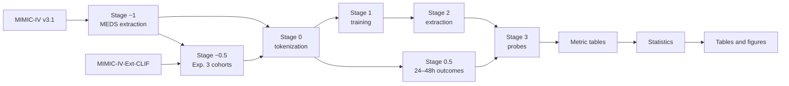

# Benchmark pipeline

This file traces each stage from raw MIMIC-IV v3.1 tables to the paper tables and figures. Launchers are in [`slurm/`](slurm/). Model scripts marked *fms-ehrs* are in the companion repository [`../fms-ehrs`](../fms-ehrs).



## Stage −1 · MIMIC-IV to MEDS

| | |
| :-- | :-- |
| Launcher | `slurm/01_phase0_extract_meds.sh` |
| Code | `benchmarks/mimic-meds-extraction/` (adapted from ETHOS-ARES) |
| Input | `physionet.org/files/mimiciv/3.1/` |
| Output | `benchmarks/mimic-meds-extraction/data/meds/data/{train,val,test}` |

## Stage −0.5 · Experiment 3 cohorts

Experiment 3 uses hospitalizations of at least 24 hours with a linked `icu/icustays` record. The launcher freezes a separate patient-level split on the native data. Then it collates the CLIF 2.1.0 tables with Cocoa under that same split.

| | |
| :-- | :-- |
| Launcher | `slurm/02_phase05_exp3_cohort_arms.sh` |
| Code | `pipeline/scripts/align_cohorts.py`, `pipeline/scripts/split_meds_by_hadm_splits.py`, *fms-ehrs* `collate_clif_with_cocoa.py` |
| Collation config | *fms-ehrs* `fms_ehrs/config/cocoa-exp3-clif-full.yaml` |
| Output | `outputs/runs/exp3/{cohort,meds_icu,meds_clif}/` |

## Stage 0 · Tokenization and base outcomes

| | |
| :-- | :-- |
| Launchers | `slurm/03_stage0_tokenize_and_outcomes_meds.sh` (Exp. 1–2), `slurm/04_exp3_stage0_tokenize_and_outcomes.sh` (Exp. 3) |
| Code | *fms-ehrs* `tokenize_w_config.py`, `pipeline/scripts/extract_outcomes_meds.py` |
| Tokenizer configs | *fms-ehrs* `mimic-meds-ed.yaml` (Exp. 1–2), `mimic-meds-exp3-full.yaml` (both Exp. 3 arms) |
| Output | `<data_version>-tokenized/train/{vocab.gzip,numeric_stats.json}`, `<data_version>[_first_24h]-tokenized/<split>/tokens_timelines.parquet`, `tokens_timelines_outcomes.parquet` |

## Stage 0.5 · Outcomes in hours 24–48

| | |
| :-- | :-- |
| Launcher | `slurm/21_submit_ml4h_24to48h_outcomes_cpu.sh` |
| Jobfiles | `utilities/scripts/generate_ml4h_24to48h_outcome_jobfiles.py` |
| Code | `pipeline/scripts/extract_outcomes_meds.py`, `pipeline/scripts/extract_extended_outcomes.py` |
| Output | `tokens_timelines_outcomes_24to48h.parquet`, `tokens_timelines_extended_outcomes_24to48h.parquet` |

Experiment 3 labels come from the native MIMIC events for the two arms.

## Stage 1 · Training

| | |
| :-- | :-- |
| Launcher | `slurm/10_submit_ml4h_campaign_stage1.sh` |
| Jobfiles | `utilities/scripts/generate_ml4h_campaign.py` |
| Code | *fms-ehrs* `tune_model.py` (Exp. 1, packed), `train_representation.py` (Exp. 2–3, windowed) |
| Output | `outputs/runs/ml4h_2026/models/` |

## Stage 2 · Hidden-state extraction

| | |
| :-- | :-- |
| Launchers | `slurm/11_submit_ml4h_exp{1,2,3}_stage2_opportunistic.sh` |
| Jobfiles | `utilities/scripts/generate_ml4h_exp{1,2,3}_stage2_jobfiles.py` |
| Code | *fms-ehrs* `extract_hidden_states.py` |
| Output | `<data_version>_first_24h-tokenized/<split>/features-<model_stem>.npy` |

## Stage 3 · Linear probes

| | |
| :-- | :-- |
| Launcher | `slurm/22_submit_ml4h_24to48h_probes.sh` (submitted by `21_*` after the outcome jobs) |
| Jobfiles | `utilities/scripts/generate_ml4h_24to48h_stage3_jobfiles.py` |
| Code | *fms-ehrs* `transfer_rep_based_preds.py` |
| Output | `<data_version>_first_24h-tokenized/test/*-preds-*.pkl` |

## Metric tables

| | |
| :-- | :-- |
| Launcher | `slurm/23_build_ml4h_metric_tables.sh` (submitted by `22_*` after the probe jobs) |
| Code | `paper/scripts/generate_ml4h_24to48h_provisional.py`, `utilities/scripts/validate_ml4h_24to48h_bundle.py` |
| Output | `metrics_long`, `run_registry`, `label_coverage_long`, and `outcome_coverage_summary` in `outputs/runs/ml4h_2026/metrics/` |

The launcher always builds all three experiments, because it replaces the full tables in `metrics/`.

## Statistics

| Analysis | Code | Launcher | Output |
| :-- | :-- | :-- | :-- |
| Hospitalization bootstrap intervals | `pipeline/scripts/bootstrap_ml4h_24to48h_metrics.py` | `slurm/28_submit_ml4h_24to48h_bootstrap.sh` | `metrics/metrics_long_with_ci.parquet` |
| Paired admission-swap tests | `pipeline/scripts/bootstrap_ml4h_family_effects.py` | `slurm/34_submit_ml4h_family_effect_bootstrap.sh` | `family_effect_bootstrap/` |
| Patient-clustered bootstrap | `pipeline/scripts/bootstrap_ml4h_patient_clusters.py` | `slurm/35_submit_ml4h_patient_clusters.sh` | `patient_cluster_bootstrap/` |
| Six-pair model-level *t*-tests | `paper/scripts/ml4h_model_level_tests.py` | — | `model_level_tests/` |

Output paths are relative to `outputs/runs/ml4h_2026/`.

## Tables and figures

See [`paper/README.md`](paper/README.md) for the script behind each table and figure.

## Checks

```bash
pytest pipeline/tests/unit
bash pipeline/tests/dryrun/run_all.sh
```
