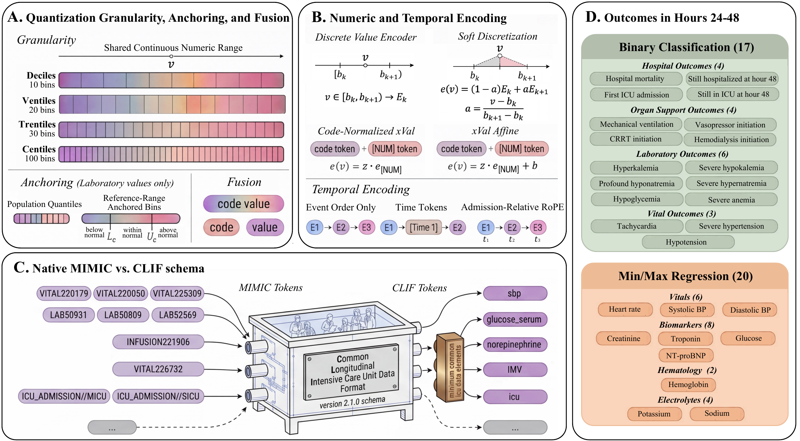

<div align="center">

# Representation Before Training

### A Practical Benchmark for Generative Medical Event Model Tokenization

[](#citation)
[](environment.yml)
[](LICENSE)
[](#benchmark-design)
[](https://doi.org/10.13026/kpb9-mt58)

Inhyeok Lee · Luke Solo · Michael C. Burkhart · Bashar Ramadan · Sahil Sethi · Sarah Jabbour · William F. Parker · Brett K. Beaulieu-Jones

University of Chicago

[Overview](#overview) · [Results](#main-results) · [Quick start](#quick-start) · [Reproduce](#reproducing-the-paper) · [Artifacts](#result-files) · [Citation](#citation)

</div>

<p align="center">
  
</p>
<p align="center"><sub><b>Figure 1.</b> Panels A–C match Experiments 1–3. Panel D is the shared evaluation on outcomes in hours 24–48.</sub></p>

---

## Overview

Tokenization decides what clinical information enters a generative medical event model. Most studies hold the tokenizer fixed and scale the architecture or the data. We hold the training recipe fixed and vary the tokenizer.

We train **156 models** (Llama-3.2-style and Qwen3-style decoders, three seeds) on full MIMIC-IV hospitalizations. Linear probes then read frozen 24-hour representations and predict outcomes in hours 24–48 across eight clinician-defined outcome families.

This repository holds the benchmark: cohort and outcome construction, Slurm orchestration, statistics, and the manuscript tables and figures. The model code (tokenizer, training, extraction, and probes) is in the companion repository [**fms-ehrs**](https://github.com/bbj-lab/fms-ehrs/tree/dev-input-rep).

## Main results

Each result below is a family-mean difference over six trained models. "Significant" means a Benjamini–Hochberg adjusted *p* < 0.05 within each table.

| Experiment | Result |
| :-- | :-- |
| **1 · Quantization and fusion** | Fused code–value deciles gave significant gains in 6 of 8 families, including all four regression families (+0.032 to +0.114 Spearman ρ). Across all six quantization schemes, fusion gave significant gains in 38 of 48 family comparisons. Finer bins and reference-range anchoring gave no consistent gain. |
| **2 · Numeric and temporal encoding** | Relative to discrete deciles, the two xVal variants had significant deficits in all 8 families. Event order and admission-relative RoPE shortened inputs and raised all 8 family means over explicit time tokens (5 and 4 significant). |
| **3 · Native MIMIC versus CLIF** | Remapping to CLIF 2.1.0 cut training tokens by 71.4% and vocabulary size by 97.8%. CLIF gave significant gains in 4 families, no significant difference in 2, and significant decreases in 2. |

Next-token training also made clinical reference ranges linearly decodable from unfused centile embeddings (93–97% accuracy).

## Benchmark design

| Experiment | Question | Factors | Configs | Runs |
| :-- | :-- | :-- | :--: | :--: |
| 1 · Quantization and fusion | Which quantization works best, and must code and value share a token? | 6 quantization schemes (deciles, ventiles, 5-10-5, trentiles, 10-10-10, centiles) × {unfused, fused} | 12 | 72 |
| 2 · Numeric and temporal encoding | Which encodings of numeric magnitude and elapsed time work best? | 4 numeric encodings (discrete, soft, xVal, affine xVal) × 3 temporal encodings (time tokens, event order, RoPE) | 12 | 72 |
| 3 · Native MIMIC versus CLIF | What changes when native events are remapped to a curated common data model? | Native MIMIC-IV MEDS versus CLIF 2.1.0, unfused deciles with time tokens | 2 | 12 |

<details>
<summary><b>Training and evaluation setup</b></summary>

<br>

| Component | Setting |
| :-- | :-- |
| Data | MIMIC-IV v3.1, patient-level 70 / 10 / 20 split |
| Test cohort | 85,057 hospitalizations from 37,234 patients (Exp. 1–2), 16,529 ICU hospitalizations (Exp. 3) |
| Decoders | Llama-3.2-style (~123.6M parameters) and Qwen3-style (~103.7M), 8 layers, 8 heads, hidden size 1024, context 4096 |
| Optimizer | AdamW, learning rate 1e-4, weight decay 0.01, batch size 4, up to 5 epochs, early stop after 3 evaluations without improvement |
| Seeds | 42, 43, 44 |
| Input window | First 24 hours of the hospitalization |
| Outcomes | Hours 24–48. 17 binary and 20 regression tasks (Exp. 1–2), 16 binary and 20 regression tasks (Exp. 3) |
| Probes | Logistic regression (`C = 0.01`) and Ridge regression (`alpha = 100`) on standardized features |
| Metrics | AUROC, Brier score, ECE (binary). Spearman ρ, R², MAE, RMSE (regression) |
| Inference | Six-pair *t*-test (df = 5) with BH adjustment within each table, plus a 1,000-draw patient-clustered bootstrap |

Parameter counts are for unfused deciles.

</details>

## Quick start

**1. Clone the three repositories side by side.**

```bash
git clone https://github.com/bbj-lab/input-representation-benchmark.git
git clone -b dev-input-rep https://github.com/bbj-lab/fms-ehrs.git
git clone https://github.com/bbj-lab/cocoa.git
git -C cocoa checkout 03f3f33f6e2ae8d2df2593966cc50bd500e57696
```

**2. Create the environment.** `environment.yml` installs Cocoa, fms-ehrs, and this repository in editable mode.

```bash
cd input-representation-benchmark
conda env create -f environment.yml
conda activate input-rep
```

**3. Get the data.** The two datasets need credentialed PhysioNet access.

| Dataset | Expected location |
| :-- | :-- |
| [MIMIC-IV v3.1](https://doi.org/10.13026/kpb9-mt58) | `physionet.org/files/mimiciv/3.1/` under the repository root |
| [MIMIC-IV-Ext-CLIF v1.1.0](https://doi.org/10.13026/j481-g420) (CLIF 2.1.0 format) | `../CLIF-SRC/mimic-2.1.0/`, or set `CLIF_SRC_DIR` |

**4. Run the checks.**

```bash
pytest pipeline/tests/unit
bash pipeline/tests/dryrun/run_all.sh
```

## Reproducing the paper

The launchers in [`slurm/`](slurm/) target the Randi cluster at the University of Chicago. For a different cluster, edit the `#SBATCH` partitions and the paths in [`slurm/00_preamble.sh`](slurm/00_preamble.sh). [`PIPELINE.md`](PIPELINE.md) lists the inputs and outputs of each stage.

| Stage | Step | Launcher | Main code |
| :--: | :-- | :-- | :-- |
| −1 | MIMIC-IV to MEDS | `01_phase0_extract_meds.sh` | `benchmarks/mimic-meds-extraction/` |
| −0.5 | Matched native and CLIF ICU cohorts | `02_phase05_exp3_cohort_arms.sh` | `align_cohorts.py`, fms-ehrs `collate_clif_with_cocoa.py` |
| 0 | Tokenization and base outcomes | `03_*`, `04_exp3_*` | fms-ehrs `tokenize_w_config.py`, `extract_outcomes_meds.py` |
| 0.5 | Outcomes in hours 24–48 | `21_submit_ml4h_24to48h_outcomes_cpu.sh` | `extract_extended_outcomes.py` |
| 1 | Train 156 models | `10_submit_ml4h_campaign_stage1.sh` | fms-ehrs `tune_model.py`, `train_representation.py` |
| 2 | Extract 24-hour hidden states | `11_submit_ml4h_exp{1,2,3}_stage2_opportunistic.sh` | fms-ehrs `extract_hidden_states.py` |
| 3 | Fit linear probes | `22_*` | fms-ehrs `transfer_rep_based_preds.py` |
| Stats | Model-level tests and bootstrap intervals | `28_*`, `34_*`, `35_*` | `bootstrap_ml4h_*.py`, `ml4h_model_level_tests.py` |
| Paper | Tables and figures | `31_rerun_ml4h_pca_probe.sh`, `33_*`, `34_rebuild_ml4h_length_histograms.sh` | `paper/scripts/` |

## Result files

The aggregated tables are in the repository. Model checkpoints, token timelines, and extracted features are not.

| File | Contents |
| :-- | :-- |
| [`metrics/metrics_long.parquet`](outputs/runs/ml4h_2026/metrics/) | Scores for every run, outcome, and metric (23,040 rows) |
| [`metrics/metrics_long_with_ci.parquet`](outputs/runs/ml4h_2026/metrics/) | Same scores with 1,000-draw hospitalization bootstrap 95% intervals |
| [`model_level_tests/family_tests.csv`](outputs/runs/ml4h_2026/model_level_tests/) | Six-pair *t*-tests and BH decisions for the 136 family comparisons in the main tables |
| [`model_level_tests/outcome_tests.csv`](outputs/runs/ml4h_2026/model_level_tests/) | The same tests at outcome level |
| [`patient_cluster_bootstrap/patient_cluster_intervals.parquet`](outputs/runs/ml4h_2026/patient_cluster_bootstrap/) | Patient-clustered bootstrap intervals |
| [`family_effect_bootstrap/family_effect_intervals.parquet`](outputs/runs/ml4h_2026/family_effect_bootstrap/) | Paired admission-swap tests, an input to the model-level test table |

All paths are relative to `outputs/runs/ml4h_2026/`. Column notes are in [`metrics/README.md`](outputs/runs/ml4h_2026/metrics/README.md).

## Repository layout

```text
input-representation-benchmark/
├── benchmarks/mimic-meds-extraction/   MIMIC-IV to MEDS extraction (adapted from ETHOS-ARES)
├── configs/                            experiment configuration
├── pipeline/
│   ├── run_experiments.py              experiment grid and jobfile generation
│   ├── task_registry.py                outcome task lists
│   ├── scripts/                        cohorts, outcomes, bootstrap and permutation tests
│   │   └── diagnostics/                embedding PCA, boundary probe, xVal and attention analyses
│   └── tests/                          unit tests and dry-run contract checks
├── paper/scripts/                      manuscript tables and figures
├── slurm/                              Slurm launchers for every stage
├── utilities/                          jobfile generators, token counts, quality checks
└── outputs/runs/ml4h_2026/             aggregated metrics and statistical tests
```

## Citation

```bibtex
@inproceedings{lee2026representation,
  title     = {Representation Before Training: A Practical Benchmark for Generative Medical Event Model Tokenization},
  author    = {Lee, Inhyeok and Solo, Luke and Burkhart, Michael C. and Ramadan, Bashar and Sethi, Sahil and Jabbour, Sarah and Parker, William F. and Beaulieu-Jones, Brett K.},
  booktitle = {Machine Learning for Health (ML4H) 2026},
  series    = {Proceedings of Machine Learning Research},
  volume    = {346},
  year      = {2026}
}
```

## License and acknowledgments

The code is released under the [MIT License](LICENSE). The MEDS extraction pipeline is adapted from [ETHOS-ARES](https://github.com/ipolharvard/ethos-ares). See [`THIRD_PARTY_NOTICES.md`](THIRD_PARTY_NOTICES.md). MIMIC-IV and MIMIC-IV-Ext-CLIF are subject to the PhysioNet credentialed data use agreement.
